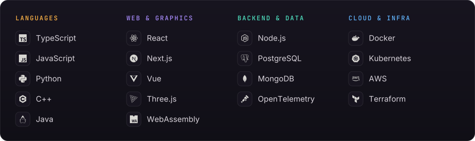

  <a href="https://invokfung.github.io/"><b>invokfung.github.io</b></a> &nbsp;·&nbsp;
  <a href="https://invokfung.github.io/explore/">The full portfolio</a> &nbsp;·&nbsp;
  <a href="https://invokfung.github.io/blog/">StudyLog</a> &nbsp;·&nbsp;
  <a href="mailto:aflung10@gmail.com">aflung10@gmail.com</a>

### From the customer's desk to production

I'm Alan, a Forward Deployed Engineer. I sit with the people who use the software, find what's actually in their way, and ship the fix.

Web developer in 2023, a new title every year since, each one closer to the people using the software.

### Seven of them, all running

Click one to try it in your browser. The source for all seven is in [invokfung.github.io](https://github.com/InvokFung/invokfung.github.io).

  
  

  
  

  
  

  
  

### What I build with

### The last year, a week a step

Off the clock I play the violin, which is why Intonation Studio can hear one.
